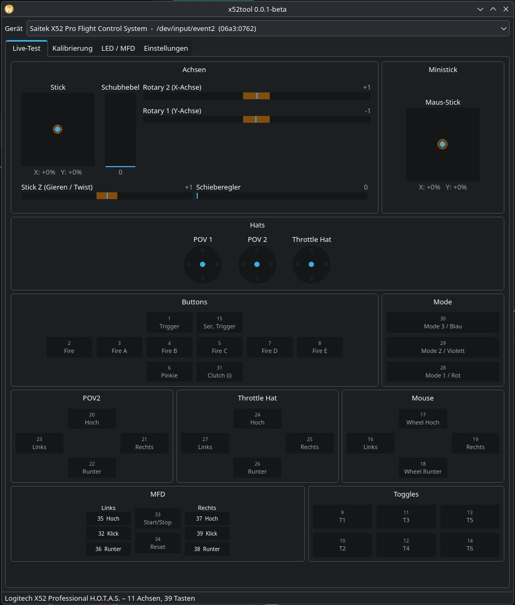
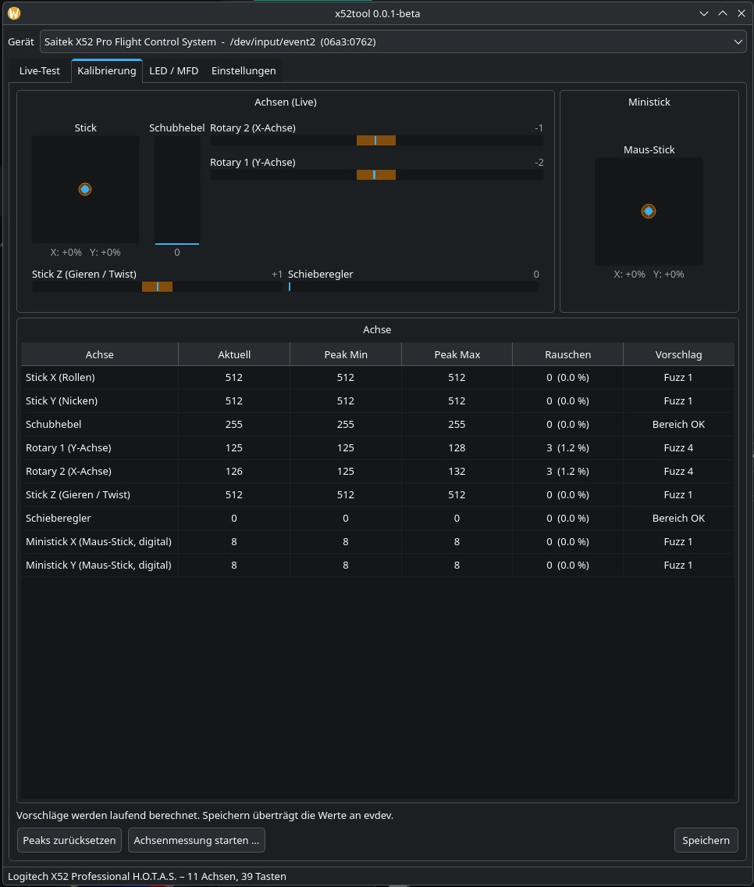
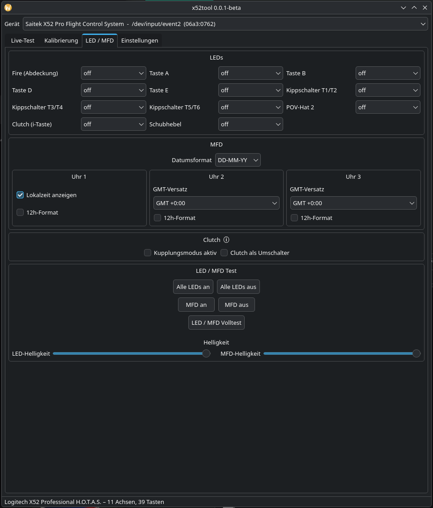
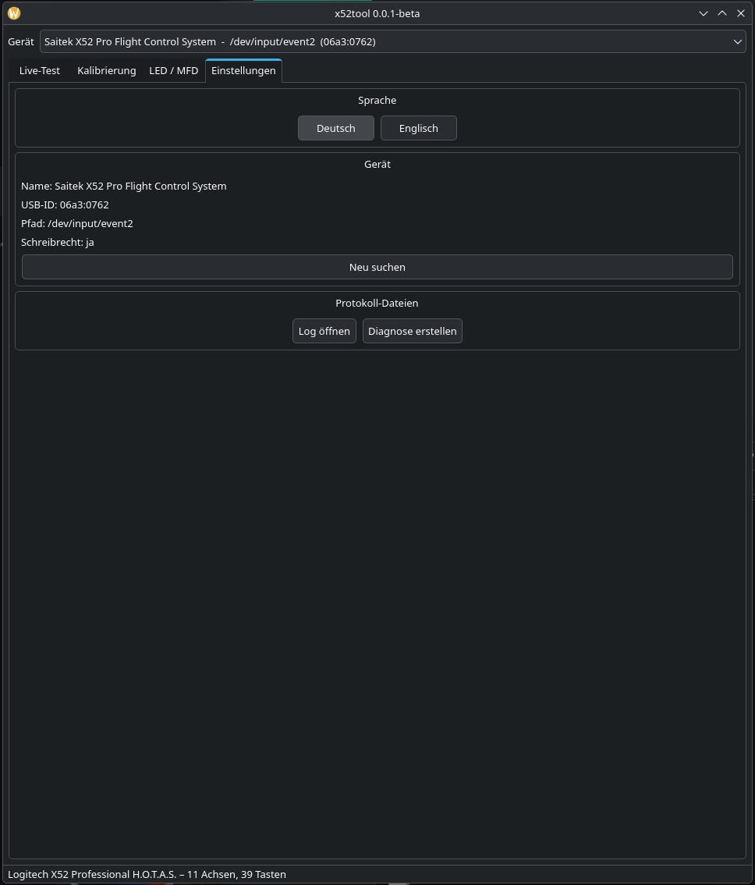

# x52tool

**Test-, Kalibrierungs- und LED/MFD-Werkzeug für den Saitek / Logitech X52 und X52 Pro unter Linux.**

[English version](README.md)

| | | | |
|---|---|---|---|
|  |  |  |  |

`x52tool` ist eine native Linux-GUI für den X52 und X52 Pro HOTAS. Das Programm zeigt, was Linux vom Gerät sieht, testet Achsen und Tasten in Echtzeit, kalibriert die Achsen, steuert LEDs, MFD-Uhr und Helligkeit und zeigt in Elite Dangerous die echten Tastennamen an – ohne Windows-Treiber.

LEDs, Uhr und Helligkeit laufen über den Hintergrunddienst `x52d` aus [libx52](https://github.com/nirenjan/libx52). Die Einstellungen bleiben dadurch auch nach einem Neustart erhalten, ohne dass `x52tool` laufen muss.

Getestet auf: **Logitech X52 Professional** (USB-ID `06a3:0762`) unter **CachyOS** (Arch-basiert).

---

## Funktionen

### Live-Test
- Echtzeit-Anzeige aller Achsen und Tasten aus Linux `evdev`
- Achsbalken mit Deadzone-Anzeige
- Tastenraster mit Live-Hervorhebung
- Ministick separat dargestellt

### Kalibrierung
- Ruherauschen wird automatisch mitgemessen
- Geführte Achsenmessung (Min/Max-Erkennung mit Checkliste)
- Deadzone- (flat) und Fuzz-Vorschläge auf Basis der Messwerte
- Direkte Übernahme in den Kernel via `EVIOCSABS`
- Speichern und Laden von Kalibrierprofilen je USB-ID

### LED / MFD
- Einzelne LED-Farben einstellen (Fire, A, B, D, E, T1/T2, T3/T4, T5/T6, POV 2, Clutch, Schubhebel)
- MFD-Uhr: Lokalzeit, 12/24h je Uhr, Datumsformat, frei wählbare Zeitzone für Uhr 2 und 3
- LED- und MFD-Helligkeit per Live-Schieberegler
- Alle LEDs an / aus, MFD an / aus
- Vollständiger LED/MFD-Test (stellt danach den eingestellten Zustand wieder her)
- Kupplungsmodus (Clutch) umschalten
- **Alle Einstellungen bleiben dauerhaft erhalten** – `x52d` setzt sie bei jedem Systemstart und beim Einstecken selbst

### Elite Dangerous
- Findet Bindings- und Journal-Ordner automatisch – auch in Steam-Bibliotheken auf anderen Laufwerken, bei Heroic, Faugus und Lutris. Bei mehreren Installationen gewinnt die zuletzt gespielte.
- Zeigt, wann `Status.json` (der Schiffszustand) zuletzt aktualisiert wurde – Grundlage für die geplanten LED-Regeln je Schiffszustand
- Installiert eigene Tastennamen (`.buttonMap`): Elite zeigt „Fire A“, „T3“, „Clutch (i)“ statt „Joy 3“ an – im Steuerungsmenü und in allen Hinweistexten
- Vorhandene fremde `.buttonMap`-Dateien werden gesichert und beim Entfernen wiederhergestellt

### Einstellungen
- Status des `x52d`-Dienstes mit Start/Stopp, Socket-Zugriff und Speicherstatus
- Geräteinformationen mit Neu-Suchen-Button
- Sprachwahl (Deutsch / Englisch)
- Log-Datei öffnen und Diagnosebericht erstellen

---

## Voraussetzungen

- Linux mit systemd
- Python 3.10 oder neuer
- PyQt6
- python-evdev
- Saitek / Logitech X52 oder X52 Pro
- `libx52` (stellt `x52d` und `x52ctl` bereit) für LEDs, MFD und Helligkeit

---

## Installation

### 1. libx52 installieren (CachyOS / Arch)

```bash
yay -S libx52
```

Für andere Distributionen: siehe https://github.com/nirenjan/libx52

### 2. x52tool installieren

Direkt von GitHub:

```bash
pip install git+https://github.com/nemwar-ed/x52tool.git --break-system-packages
```

Oder aus dem geklonten Repository in einer virtuellen Umgebung:

```bash
git clone https://github.com/nemwar-ed/x52tool.git
cd x52tool
python3 -m venv .venv
.venv/bin/pip install -r requirements.txt
```

### 3. Einmalige Systemeinrichtung

```bash
sudo bash install.sh
```

Das Skript (mehrfach ausführbar, vorhandene Einstellungen bleiben):

- prüft, ob `x52d` und `x52ctl` installiert sind, und aktiviert den Dienst `x52d`
- legt `/var/lib/x52tool/x52d.conf` an – eine Kopie der x52d-Konfiguration, die deinem Benutzer gehört
- richtet ein systemd-Drop-in ein, damit `x52d` genau diese Datei lädt und sein Socket `/run/x52d.cmd` ohne `sudo` erreichbar ist

Danach läuft `x52tool` ohne Root-Rechte.

### 4. Starten

```bash
x52tool              # nach pip install
./run.sh             # aus dem Repository
```

---

## Wie die Einstellungen gespeichert werden

```
x52tool  ──x52ctl──▶  x52d (Dienst, root)  ──USB──▶  X52 Pro
   │                       ▲
   └─ schreibt ──▶ /var/lib/x52tool/x52d.conf ─┘ wird beim Start geladen
```

Jede Änderung an LEDs, Uhr oder Helligkeit wirkt sofort (per `x52ctl`) und wird zusätzlich in `/var/lib/x52tool/x52d.conf` geschrieben. Beim nächsten Systemstart lädt `x52d` diese Datei selbst.

Warum nicht `x52ctl config save`? In der getesteten libx52-Version meldet der Befehl „OK“, speichert aber nichts.

Ob alles eingerichtet ist, zeigt der Reiter **Einstellungen → x52d Dienst**. Steht dort „Einstellungen gehen beim Neustart verloren“, `sudo bash install.sh` erneut ausführen.

---

## Kommandozeile

Erkannte Geräte ohne GUI auflisten:

```bash
python3 -m x52tool --list
```

Gespeichertes Kalibrierprofil anwenden:

```bash
python3 -m x52tool --apply
python3 -m x52tool --apply --device /dev/input/event7
```

---

## Dateien

| Was | Wo |
|---|---|
| Einstellungen und Kalibrierprofile | `~/.config/x52tool/config.json` |
| x52d-Konfiguration (LEDs, Uhr, Helligkeit) | `/var/lib/x52tool/x52d.conf` |
| systemd-Drop-in | `/etc/systemd/system/x52d.service.d/x52tool-socket.conf` |
| Logs | `~/.local/share/x52tool/x52tool.log`, `x52tool-diag.log` |
| Elite-Tastennamen | `…/Elite Dangerous/Options/Bindings/DeviceButtonMaps/` |
| Elite-Journal / Status.json (nur gelesen) | `…/drive_c/users/steamuser/Saved Games/Frontier Developments/Elite Dangerous/` |

### Projektstruktur

```
x52tool/
├── install.sh          einmalige Systemeinrichtung
├── run.sh              Start ohne Installation
├── CHANGELOG.md
└── x52tool/
    ├── device.py       Geräteerkennung, evdev, ABS-Ioctls
    ├── analysis.py     Ruhe- und Bereichsmessung
    ├── noise.py        Rauschmessung (Ringpuffer)
    ├── axis_type.py    Achstypen (federzentriert, Schieber, Rastung)
    ├── output.py       LEDs / MFD / Uhr über x52ctl
    ├── x52d_conf.py    dauerhafte x52d-Konfiguration
    ├── service.py      Status / Start / Stopp von x52d
    ├── config.py       Einstellungen und Profile
    ├── elite/          Elite Dangerous (Bindings-Suche, .buttonMap)
    ├── lang/           de.lng, en.lng
    └── ui/             ein Modul pro Reiter
```

---

## Fehlersuche

```bash
systemctl status x52d                       # läuft der Dienst?
journalctl -u x52d -b                       # Meldungen seit dem Systemstart
x52ctl config get Clock FormatPrimary       # antwortet der Dienst?
cat /var/lib/x52tool/x52d.conf              # gespeicherte Werte
```

---

## KI-gestützte Entwicklung

`x52tool` wurde mit Unterstützung von **Anthropic Claude** entwickelt. Aller Code wird vor dem Commit auf echter Linux- / X52-Pro-Hardware überprüft und getestet.

---

## Mitmachen

Fehlerberichte, Tests auf anderer X52- / X52-Pro-Hardware und Verbesserungsvorschläge sind willkommen.

Für Fehlerberichte bitte folgendes mitschicken:

- Distribution und Version
- Kernel-Version
- X52 oder X52 Pro
- Ausgabe von `lsusb`
- Ausgabe von `python3 -m x52tool --list`
- Fehlermeldungen aus dem Terminal
- Den Diagnosebericht aus Einstellungen → Diagnose erstellen

---

## Lizenz

`x52tool` wird unter der **GNU General Public License v3.0** veröffentlicht. Siehe `LICENSE`.

`libx52` ist ein eigenständiges Projekt mit eigener Lizenz: https://github.com/nirenjan/libx52

---

## Links

- libx52: https://github.com/nirenjan/libx52
- libx52 im AUR: https://aur.archlinux.org/packages/libx52
- python-evdev: https://python-evdev.readthedocs.io/
- Elite Custom Button Names (Vorlage für die Tastennamen): https://github.com/EDCD/EliteCustomButtonNames
