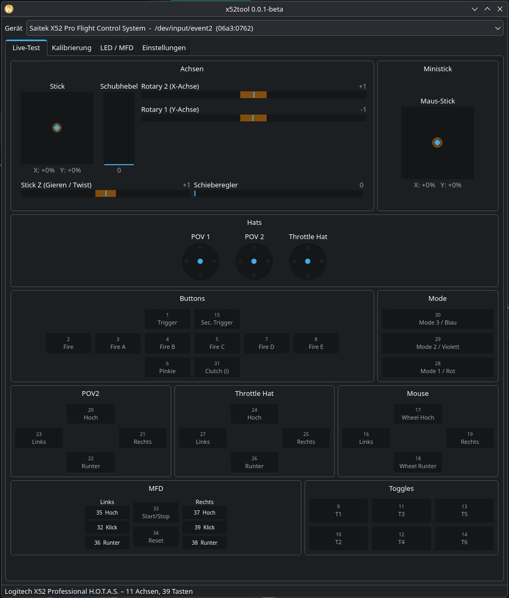
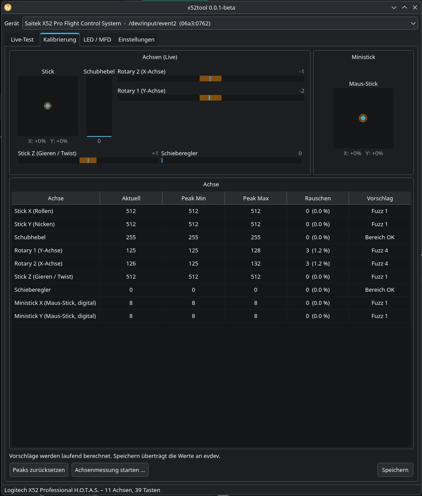
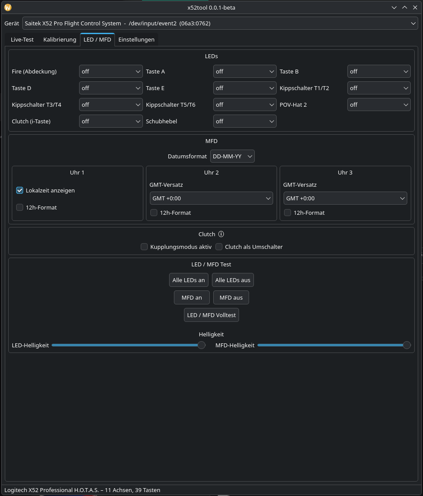
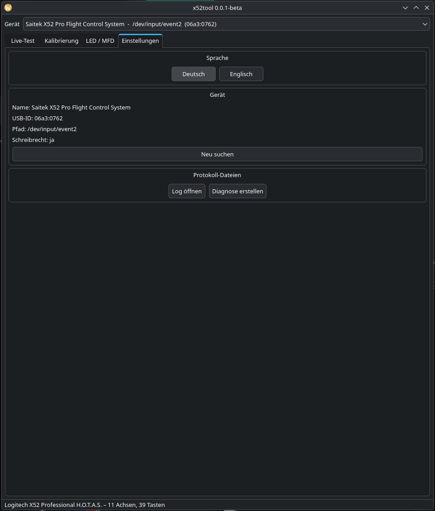

# x52tool

**Test, calibration and LED/MFD tool for the Saitek / Logitech X52 and X52 Pro on Linux.**

[Deutsche Version](README.de.md)

| | | | |
|---|---|---|---|
|  |  |  |  |

`x52tool` is a native Linux GUI for the X52 and X52 Pro HOTAS. It shows what Linux sees from the device, tests axes and buttons in real time, calibrates the axes, controls LEDs, the MFD clock and brightness, and makes Elite Dangerous show the real button names — no Windows driver needed.

LEDs, clock and brightness are handled by the `x52d` background service from [libx52](https://github.com/nirenjan/libx52), so your settings survive a reboot without `x52tool` having to run.

Tested on: **Logitech X52 Professional** (USB-ID `06a3:0762`) on **CachyOS** (Arch-based).

---

## Features

### Live Test
- Real-time display of all axes and buttons as reported by Linux `evdev`
- Axis bars with deadzone indicator
- Button grid with live highlighting
- Ministick shown separately

### Calibration
- Idle noise is measured automatically in the background
- Guided axis measurement (min/max detection with checklist)
- Deadzone (flat) and fuzz suggestions based on measured values
- Write calibration directly to the kernel via `EVIOCSABS`
- Save and load calibration profiles per USB-ID

### LED / MFD
- Set individual LED colours (Fire, A, B, D, E, T1/T2, T3/T4, T5/T6, POV 2, Clutch, Throttle)
- MFD clock: local time, 12/24h per clock, date format, any timezone for clocks 2 and 3
- LED and MFD brightness sliders (live)
- All LEDs on / off, MFD on / off
- Full LED/MFD test sequence (restores your settings afterwards)
- Clutch mode toggle
- **All settings are permanent** — `x52d` applies them on every boot and whenever the device is plugged in

### Elite Dangerous
- Finds the Bindings folder automatically (all Steam libraries, Heroic, Faugus, Lutris)
- Installs custom button names (`.buttonMap`): Elite shows "Fire A", "T3", "Clutch (i)" instead of "Joy 3" — in the controls menu and in all in-game hints
- Existing third-party `.buttonMap` files are backed up and restored on removal

### Settings
- `x52d` service status with start/stop, socket access and persistence status
- Device info with rescan button
- Language switching (German / English)
- Log file access and diagnostic report generation

---

## Requirements

- Linux with systemd
- Python 3.10 or newer
- PyQt6
- python-evdev
- Saitek / Logitech X52 or X52 Pro
- `libx52` (provides `x52d` and `x52ctl`) for LEDs, MFD and brightness

---

## Installation

### 1. Install libx52 (CachyOS / Arch)

```bash
yay -S libx52
```

For other distributions see https://github.com/nirenjan/libx52

### 2. Install x52tool

Straight from GitHub:

```bash
pip install git+https://github.com/nemwar-ed/x52tool.git --break-system-packages
```

Or from a cloned repository in a virtual environment:

```bash
git clone https://github.com/nemwar-ed/x52tool.git
cd x52tool
python3 -m venv .venv
.venv/bin/pip install -r requirements.txt
```

### 3. One-time system setup

```bash
sudo bash install.sh
```

The script (safe to run again, existing settings are kept):

- checks that `x52d` and `x52ctl` are installed and enables the `x52d` service
- creates `/var/lib/x52tool/x52d.conf` — a copy of the x52d configuration owned by your user
- adds a systemd drop-in so `x52d` loads exactly that file and its socket `/run/x52d.cmd` is reachable without `sudo`

After that, `x52tool` runs without root.

### 4. Run

```bash
x52tool              # after pip install
./run.sh             # from the repository
```

---

## How settings are saved

```
x52tool  ──x52ctl──▶  x52d (service, root)  ──USB──▶  X52 Pro
   │                       ▲
   └─ writes ──▶ /var/lib/x52tool/x52d.conf ─┘ loaded on start
```

Every change to LEDs, clock or brightness takes effect immediately (via `x52ctl`) and is also written to `/var/lib/x52tool/x52d.conf`. On the next boot, `x52d` loads that file by itself.

Why not `x52ctl config save`? In the tested libx52 version it replies "OK" but saves nothing.

**Settings → x52d Service** shows whether everything is set up. If it says "Settings are lost on restart", run `sudo bash install.sh` again.

---

## Command line

List detected devices without the GUI:

```bash
python3 -m x52tool --list
```

Apply the saved calibration profile:

```bash
python3 -m x52tool --apply
python3 -m x52tool --apply --device /dev/input/event7
```

---

## Files

| What | Where |
|---|---|
| Settings and calibration profiles | `~/.config/x52tool/config.json` |
| x52d configuration (LEDs, clock, brightness) | `/var/lib/x52tool/x52d.conf` |
| systemd drop-in | `/etc/systemd/system/x52d.service.d/x52tool-socket.conf` |
| Logs | `~/.local/share/x52tool/x52tool.log`, `x52tool-diag.log` |
| Elite button names | `…/Elite Dangerous/Options/Bindings/DeviceButtonMaps/` |

### Project layout

```
x52tool/
├── install.sh          one-time system setup
├── run.sh              run without installing
├── CHANGELOG.md
└── x52tool/
    ├── device.py       device detection, evdev, ABS ioctls
    ├── analysis.py     idle and range measurement
    ├── noise.py        noise measurement (ring buffer)
    ├── axis_type.py    axis types (spring-centred, slider, detent)
    ├── output.py       LEDs / MFD / clock via x52ctl
    ├── x52d_conf.py    persistent x52d configuration
    ├── service.py      x52d status / start / stop
    ├── config.py       settings and profiles
    ├── elite/          Elite Dangerous (bindings lookup, .buttonMap)
    ├── lang/           de.lng, en.lng
    └── ui/             one module per tab
```

---

## Troubleshooting

```bash
systemctl status x52d                       # is the service running?
journalctl -u x52d -b                       # messages since boot
x52ctl config get Clock FormatPrimary       # does the service answer?
cat /var/lib/x52tool/x52d.conf              # saved values
```

---

## AI-assisted development

`x52tool` was developed with the help of **Anthropic Claude**. All code is reviewed and tested on real Linux / X52 Pro hardware before it is committed.

---

## Contributing

Bug reports, tests on other X52 / X52 Pro hardware, and improvements are welcome.

For bug reports, please include:

- Distribution and version
- Kernel version
- X52 or X52 Pro
- Output of `lsusb`
- Output of `python3 -m x52tool --list`
- Any error messages from the terminal
- The diagnostic log from Settings → Create Diagnostic

---

## License

`x52tool` is released under the **GNU General Public License v3.0**. See `LICENSE`.

`libx52` is a separate project with its own license: https://github.com/nirenjan/libx52

---

## Links

- libx52: https://github.com/nirenjan/libx52
- libx52 on AUR: https://aur.archlinux.org/packages/libx52
- python-evdev: https://python-evdev.readthedocs.io/
- Elite Custom Button Names (basis for the button names): https://github.com/EDCD/EliteCustomButtonNames
